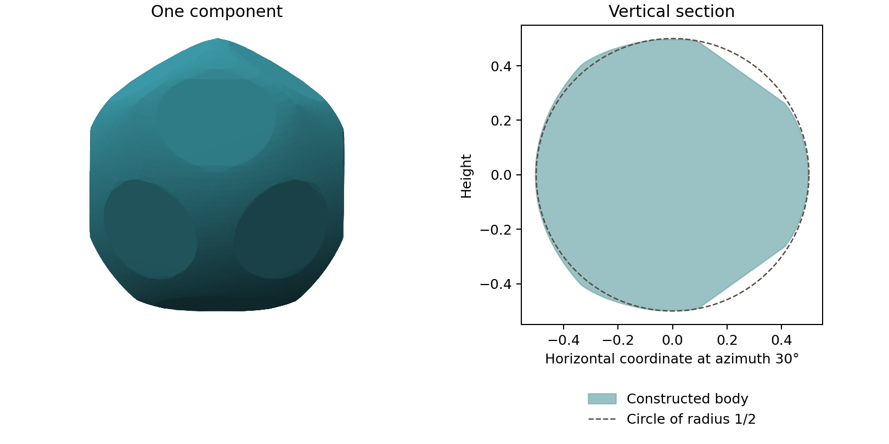
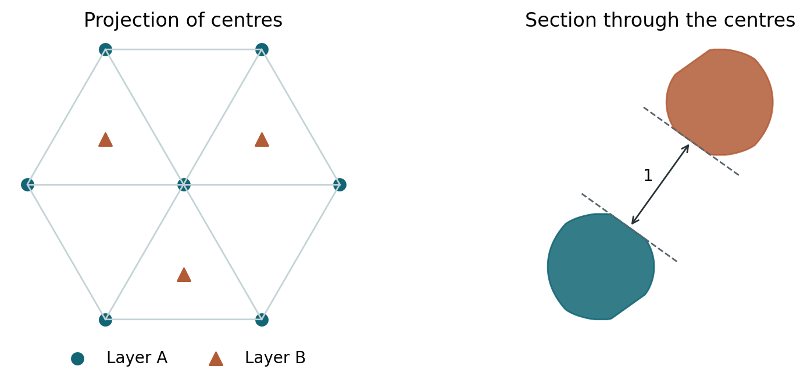

# Unit-distance avoidance in three dimensions

This construction improves the [certified lower bound](https://github.com/vsvor/m1_R3) for the supremal density of measurable subsets of
$\mathbb R^3$ avoiding unit distances from **$m_1(\mathbb R^3)\ge0.0990344$** to **$m_1(\mathbb R^3)\ge0.099450499$**. A convex polytope and its central reflection are placed in alternating triangular layers. Using the new component on standard hexagonal close-packing (HCP) centres gives **$m_1(\mathbb R^3)\ge0.099432586$**; adjusting the layer height gives the stronger bound.



*Left, the component rendered from subsampled points. Right, its vertical profile at azimuth 30°. The dashed circle has radius 1/2. The same figure appears in the PDF.*

## Run the exact verification

Python 3.9 or later is sufficient. The verifier uses the standard library and arbitrary-precision integers.

From the unpacked directory, run

```sh
python3 verify.py
```

To verify one construction, run

```sh
python3 verify.py hcp
python3 verify.py ab
```

Each run checks the compressed data's SHA-256 hash, reads the coordinates, verifies every geometric condition, computes the volume certificate and compares the result with the reference integers in [certificates.json](certificates.json). A failed condition raises an error and returns a nonzero exit status. The diameter check can take several minutes with CPython.

| Construction | Input | Points | Certified conclusion |
|---|---|---:|---|
| Standard HCP | [data/hcp.txt.gz](data/hcp.txt.gz) | 157,528 | $m_1(\mathbb R^3)\ge0.099432586$ |
| Modified layer height | [data/ab.txt.gz](data/ab.txt.gz) | 160,229 | $m_1(\mathbb R^3)\ge0.099450499$ |

The final output lines are

```text
m_1(R^3) >= 0.099432586
m_1(R^3) >= 0.099450499
```

The program computes these bounds from the coordinates. The reference values are used only for the final comparison.

## Body and coordinates



*Left, centres in one layer and projections of three centres in the next layer. Right, mutually reflected components separated by a strip of width one.*

Each decompressed file starts with $S, D, H$ and the number of horizontal sections. A section block starts with $z$ and the number of points, followed by pairs $x,y$. Its physical points are

$$T(x,y,z)=\frac{1}{S}(x,\sqrt3y,\sqrt6z).$$

Let $P$ be the list of all integer triples, $K$ its convex hull and $J = T(K)$. The component is the interior of $J$. The integer coordinates use the scalar product

$$[p,q]=p_xq_x+3p_yq_y+6p_zq_z,\qquad g(p)=[p,p].$$

Thus the physical squared distance is $g(p−q)/S^2$.

## Periodic placement

Before applying T, define

$$e_1=(D,0,0),\quad e_2=(D/2,D/2,0),\quad t=(D/2,D/6,H).$$

The period lattice $L$ is generated by $e_1, e_2$ and $(0,0,2H)$. Put copies of the interior of $J$ at $T(L)$, and copies of its central reflection at $T(t+L)$. The horizontal step is $D/S$ and the layer height is $\sqrt{6} H/S$. Standard HCP has $H = D/3$.

The twelve neighbour offsets V consist of $±e_1, ±e_2, ±(e_2−e_1)$ and six offsets with heights ±H and horizontal coordinates

$$(D/2,D/6),\quad(-D/2,D/6),\quad(0,-D/3).$$

## What the verifier proves

### Diameter within a component

The program verifies $g(p−q) ≤ S^2$ for all pairs of input points. For convex combinations $x = \sum_i \alpha_i T(p_i)$  and $y = \sum_j \beta_j T(q_j)$, the triangle inequality gives

$$|x-y|\le\sum_{i,j}\alpha_i\beta_j|T(p_i-q_j)|\le1.$$

The distance between two interior points is strictly smaller than one, because a pair attaining one could be moved slightly farther apart inside the body.

The verifier encloses groups of points in coordinate boxes. For boxes $[l,u]$ and $[l′,u′]$, let $b_j = max(u_j−l′_j, u′_j−l_j)$. Then every represented pair satisfies $g(p−q) ≤ g(b)$. A box pair is accepted only if this upper bound is at most $S^2$. Other pairs are subdivided until direct point comparisons suffice. The recursion starts with the entire list paired with itself, so it covers every pair.

### Neighbouring components

For every $p \in P$ and $v \in V$, the verifier computes $c = g(v) − 2[v,p]$ and checks

$$c\ge0,\qquad c^2\ge S^2g(v).$$

These integer conditions are equivalent to

$$n\cdot x\le (r-1)/2,\qquad n=T(v)/|T(v)|,\quad r=|T(v)|,$$

for every $x$ in $J$. The inequality is strict in the interior. For a neighbour in the same layer, the opposite vector $−v$ provides the facing plane. For a neighbour in the next layer, reflection of the component provides that plane. The projection of the difference of two interior points on $n$ is therefore greater than one.

### Every remaining component

The program checks $25g(p) < 9S^2$ for every point. Hence $J$ lies in the ball of radius $3/5$. All remaining centre offsets have squared distance, before division by $S^2$, at least

$$\text{min}[3D^2; 4D^2/3+6H^2; 24H^2].$$

In one layer the horizontal form is $D^2(i^2+ij+j^2)$. After its minimum positive value $D^2$, the next possible value is at least $3D^2$. Between adjacent layers the horizontal form is $D^2(i^2+ij+j^2+i+j+1/3)$. Its minimum $D^2/3$ occurs exactly at the three specified neighbours, and the next value is at least $4D^2/3$. Layers at least two steps apart have vertical squared distance at least $24H^2$.

The verifier checks that all three bounds exceed $(11S/5)^2$. The distance between the corresponding components is then greater than $11/5 − 2(3/5) = 1$. These arguments account for all pairs in the infinite periodic set.

### Exact lower bound for the volume

Let $a_i$ be twice the area of the polygon obtained by taking the convex hull of the points at height $z_i$. The program obtains $a_i$ by the monotone-chain hull algorithm and integer determinants.

Between consecutive heights, convexity gives a section containing $(1−s)Q_i + sQ_{i+1}$. The planar Brunn–Minkowski inequality bounds its area below by

$$\frac12\big((1-s)\sqrt{a_i}+s\sqrt{a_{i+1}}\big)^2.$$

Integrating over the height interval yields a lower bound for six times the layer volume of

$$(z_{i+1}-z_i)(a_i+a_{i+1}+\sqrt{a_ia_{i+1}}).$$

The harmonic mean $\frac{a_i a_{i+1}}{a_i + a_{i+1}}$ is at most $\sqrt{a_ia_{i+1}}$. Rounding it down and summing gives the integer certificate

$$N=\sum_i(z_{i+1}-z_i)\left(a_i+a_{i+1}+\left\lfloor\frac{2a_ia_{i+1}}{a_i+a_{i+1}}\right\rfloor\right)\le6 \cdot \text{vol}(K).$$

There are two components per period cell of volume $D^2H$. The coordinate transformation has the same Jacobian for the components and the cell, so it cancels. With $M = 3D^2H$, this proves

$$m_1(\mathbb R^3)\ge\frac{2 \cdot \text{vol}(K)}{D^2H}\ge\frac{N}{M}.$$

| Construction | N | M |
|---|---:|---:|
| Standard HCP | 695014335915313293 | 6989804462486944008 |
| Modified layer height | 695093978461504066 | 6989346271933279848 |

The displayed nine-digit lower bounds are computed as floor(10⁹N/M)/10⁹.

## Checks of the implementation

Run the small independent checks with

```sh
python3 -m unittest -v
```

They compare the box algorithm against exhaustive pairwise distances, test polygon areas and a prism volume, and check rejection of invalid geometry and malformed data. The full verification is performed by verify.py.

## Regenerate the illustrations

The optional rendering scripts use NumPy, SciPy and Matplotlib. Run them from the repository root.

```sh
python3 figures/draw.py
python3 figures/placement.py
```

The rendering scripts use floating-point arithmetic for visualization. The exact verification reads the integer coordinate files directly.
